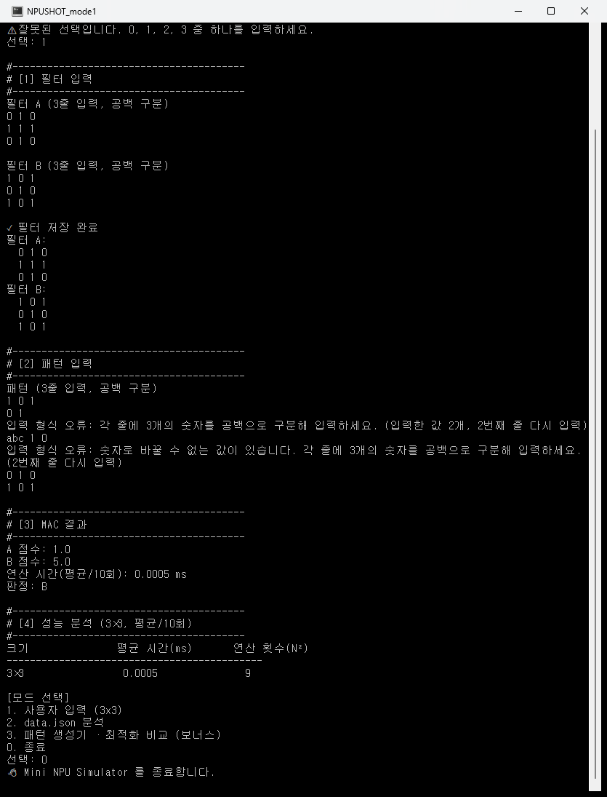
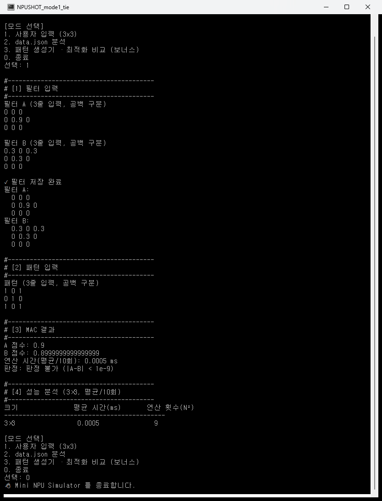
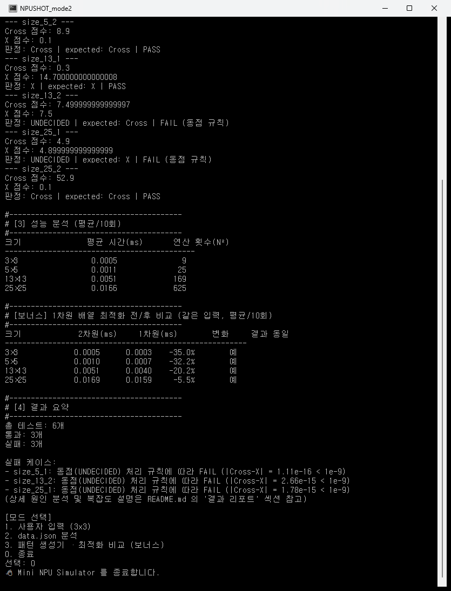
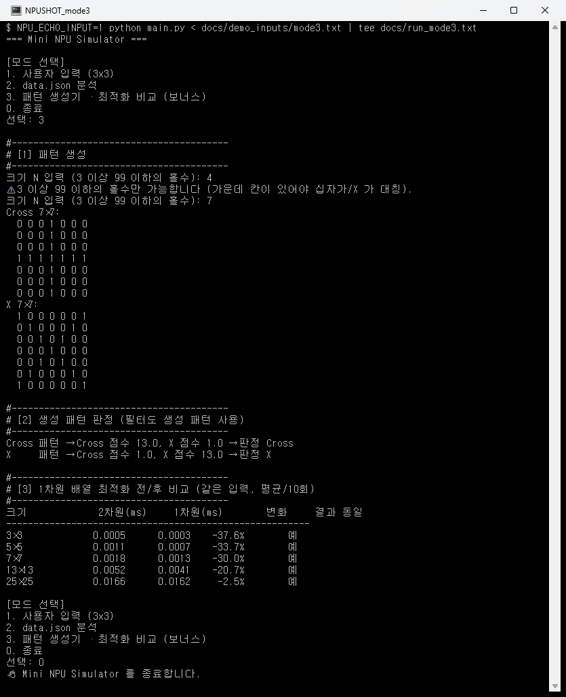

# 🧮 Mini NPU Simulator — MAC 연산으로 패턴 판별하기

필터와 패턴을 같은 위치끼리 곱하고 모두 더하는 **MAC(Multiply-Accumulate) 연산**으로 십자가(Cross)와 X 패턴을 판별하는 Python 콘솔 프로그램입니다. 3×3 직접 입력, `data.json` 일괄 분석(5×5 · 13×13 · 25×25), 크기별 성능 측정을 지원합니다. NumPy 같은 외부 라이브러리 없이 반복문으로 직접 구현했습니다.

## 목차
1. [실행 방법](#1-실행-방법)
2. [구현 요약](#2-구현-요약)
3. [결과 리포트](#3-결과-리포트)
4. [보너스 과제](#4-보너스-과제)
5. [파일 구조](#5-파일-구조)
6. [테스트 · 실행 기록](#6-테스트--실행-기록)
7. [개념 정리](#7-개념-정리)
8. [Git 작업 기록](#8-git-작업-기록)

---

## 1. 실행 방법

```bash
python main.py        # Windows 에서 python 이 없다고 나오면: py main.py
```

| 선택 | 모드 | 흐름 |
|---|---|---|
| `1` | 사용자 입력 (3×3) | 필터 A, B 입력 → 저장 확인 → 패턴 입력 → MAC 연산 → 판정(A / B / 판정 불가) → 성능 분석(3×3) |
| `2` | data.json 분석 | 필터 로드 → 패턴 로드·검증 → MAC·판정·PASS/FAIL → 성능 분석(3×3·5×5·13×13·25×25) → 결과 요약 |
| `3` | 패턴 생성기 · 최적화 비교 (보너스) | N 입력 → Cross / X 패턴 자동 생성 → 판정 → 2차원 vs 1차원 MAC 성능 비교 |
| `0` | 종료 | |

- **data.json 위치**: `main.py` 와 같은 폴더 (어디서 실행해도 `main.py` 기준으로 찾음)
- **입력 형식(모드 1)**: 한 줄에 숫자 3개를 공백으로 구분, 3줄. 예) `0 1 0`
- **환경**: Python 3.8 이상, 표준 라이브러리만 사용 (`json`, `time`, `re`, `math`, `pathlib`, `unittest`)
- 측정 환경: Python 3.12.10 / Windows 11

## 2. 구현 요약

### 데이터 구조 — `Matrix`
- n×n 2차원 리스트를 감싼 클래스. `get(행, 열)` / `set(행, 열, 값)` 으로 특정 위치를 읽고 쓴다
- `Matrix.from_rows()` 가 정사각형 여부·숫자 여부를 검증 (3×3 ~ 25×25 이상 처리 가능)

### MAC 연산 — `mac(pattern, filter)`
```python
total = 0.0
for i in range(N):            # 행
    for j in range(N):        # 열
        total += pattern[i][j] * filter[i][j]   # Multiply → Accumulate
```
- 외부 라이브러리 없이 이중 반복문으로 N² 번 곱하고 더한다. 크기가 다르면 `ValueError`

### 라벨 정규화 (표준 라벨: `Cross`, `X`)
| 원본 표기 | 나오는 곳 | 표준 라벨 |
|---|---|---|
| `+` | patterns 의 `expected` | `Cross` |
| `cross` | filters 의 키 | `Cross` |
| `x` | `expected`, filters 의 키 | `X` |

- 대소문자·앞뒤 공백을 무시하고 위 표로 변환, 그 외 값은 오류(해당 케이스 FAIL)
- **왜 필요한가**: 같은 뜻인데 데이터 안에서 `+` 와 `cross` 처럼 표기가 다르다. 그대로 비교하면 `'+' != 'cross'` 라서 맞는 판정도 FAIL 이 된다. 입력 단계에서 한 가지 표기로 통일하면, 이후 판정·출력·PASS/FAIL 비교는 표준 라벨만 신경 쓰면 된다.

### data.json 키 규칙
- `filters.size_N` → N×N 필터 묶음 (`cross`, `x`)
- `patterns.size_N_idx` → 정규식 `^size_(\d+)_(\d+)$` 로 **N 을 추출**해 `size_N` 필터를 선택
- 키 형식 오류 / input·expected 누락 / 라벨 오류 / 필터 없음 / 크기 불일치 → **프로그램은 계속, 해당 케이스만 FAIL + 사유 기록**

### 점수 비교 정책 (epsilon)
```python
if abs(score_a - score_b) < 1e-9:   # 허용오차 안이면 동점
    return "UNDECIDED"
return "A" if score_a > score_b else "B"
```
- 동점이면 판정 불가(`UNDECIDED`), expected 와 다르므로 FAIL
- 모드 1 입력 검증: 숫자 개수가 3개가 아님 / 숫자로 변환 불가 / inf·nan → 안내 후 **그 줄을 다시 입력**. Ctrl+C·입력 종료에도 traceback 없이 종료

## 3. 결과 리포트

### 3-1. data.json 분석 결과 — 총 6개, 통과 3개, 실패 3개

| 케이스 | Cross 점수 | X 점수 | 차이 | 판정 | expected → 결과 |
|---|---|---|---|---|---|
| `size_5_1` | `0.9` | `0.8999999999999999` | 1.11e-16 | UNDECIDED (단순 비교라면 Cross) | X → **FAIL** |
| `size_5_2` | `8.9` | `0.1` | 8.8 | Cross (단순 비교라면 Cross) | Cross → **PASS** |
| `size_13_1` | `0.3` | `14.700000000000008` | 14.4 | X (단순 비교라면 X) | X → **PASS** |
| `size_13_2` | `7.499999999999997` | `7.5` | 2.66e-15 | UNDECIDED (단순 비교라면 X) | Cross → **FAIL** |
| `size_25_1` | `4.9` | `4.899999999999999` | 1.78e-15 | UNDECIDED (단순 비교라면 Cross) | X → **FAIL** |
| `size_25_2` | `52.9` | `0.1` | 52.8 | Cross (단순 비교라면 Cross) | Cross → **PASS** |

실패 케이스:
- `size_5_1`: 동점(UNDECIDED) 처리 규칙에 따라 FAIL (|Cross-X| = 1.11e-16 < 1e-9)
- `size_13_2`: 동점(UNDECIDED) 처리 규칙에 따라 FAIL (|Cross-X| = 2.66e-15 < 1e-9)
- `size_25_1`: 동점(UNDECIDED) 처리 규칙에 따라 FAIL (|Cross-X| = 1.78e-15 < 1e-9)

### 3-2. 실패 원인 분석

실패 원인을 **데이터/스키마 문제 · 로직 문제 · 수치 비교 문제**로 나눠 확인했다.

1. **데이터/스키마 문제가 아니다.** 6개 케이스 모두 키에서 N 을 정상 추출했고, 필터·패턴 크기가 일치했으며, `+`/`x`/`cross` 라벨도 정규화 후 올바르게 매칭됐다 (스키마 오류였다면 점수 대신 사유가 출력된다).
2. **MAC 로직 문제도 아니다.** 통과한 3개 케이스는 점수 차이가 커서 정답과 일치했고, 단위 테스트에서 미션 예시(십자가×십자가 = 5, 십자가×X = 1)와 2차원/1차원 결과 일치를 확인했다.
3. **실패 3건은 모두 "수학적으로 정확히 같은 점수"가 나오는 케이스다.** 손으로 계산하면:
   - `size_5_1` (X 패턴): Cross 필터는 가운데 한 칸만 0.9 → 1×0.9 = **0.9**, X 필터는 대각선 9칸이 0.1 → 9×0.1 = **0.9**
   - `size_13_2` (십자가 패턴): Cross 필터 25칸 × 0.3 = **7.5**, X 필터는 가운데 한 칸만 7.5 → **7.5**
   - `size_25_1` (X 패턴): Cross 필터 가운데 4.9 → **4.9**, X 필터 대각선 49칸 × 0.1 = **4.9**
4. 그런데 컴퓨터는 0.1, 0.3 을 2진수로 정확히 표현하지 못해 더하는 순서에 따라 `0.8999999999999999`, `7.499999999999997` 처럼 **10⁻¹⁵ 수준의 오차**가 생긴다.
5. epsilon 없이 `>` 로 비교했다면 이 미세한 오차 때문에 size_5_1 → Cross, size_13_2 → X, size_25_1 → Cross 로 **엉뚱한 확정 판정**이 나왔을 것이다 (표의 "단순 비교라면" 열). 결과가 맞든 틀리든, 반올림 오차가 판정을 결정하는 것 자체가 잘못이다.
6. `|A-B| < 1e-9` 정책은 이런 오차를 동점으로 흡수해 **"판별 근거가 없다(UNDECIDED)"** 고 정직하게 보고한다. 1e-9 는 실제 점수 차이(0.1 이상)보다 훨씬 작고, 부동소수점 오차(약 10⁻¹⁵)보다는 훨씬 커서 둘을 확실히 구분한다.
7. 따라서 이 FAIL 은 프로그램 오류가 아니라 **필터 가중치 설계 문제**다. 가운데 한 칸에 큰 가중치(0.9, 7.5, 4.9)를 몰아준 필터가 반대 모양의 패턴과도 같은 점수를 만들어 두 필터가 이 입력을 구별하지 못한다.
8. 개선 방향: (a) 필터 가중치를 모양 전체에 고르게 분배, (b) 점수를 필터 가중치 합으로 나눈 정규화 점수 사용, (c) 동점 시 2차 기준(예: 일치 칸 수) 도입. 다만 과제의 비교 정책(동점 = UNDECIDED = FAIL)은 그대로 지켜, 점수를 억지로 맞추지 않았다.
9. 의도적 오류 데이터(크기 불일치·필터 없음·라벨 오류·키 오류·expected 누락)는 단위 테스트에서 각각 **케이스 단위 FAIL + 사유**로 처리되고 프로그램이 멈추지 않는 것을 확인했다.

### 3-3. 성능 분석 (MAC 함수 호출 구간만, 크기별 10회 평균)

| 크기(N×N) | 평균 시간(ms) | 연산 횟수(N²) |
|---|---|---|
| 3×3 | 0.0005 | 9 |
| 5×5 | 0.0011 | 25 |
| 13×13 | 0.0051 | 169 |
| 25×25 | 0.0166 | 625 |

| 크기 변화 | 연산 횟수 증가 | 실제 시간 증가 |
|---|---|---|
| 5×5 → 13×13 | 6.8배 | 4.8배 |
| 13×13 → 25×25 | 3.7배 | 3.2배 |
| 5×5 → 25×25 | 25.0배 | 15.4배 |

### 3-4. 시간 복잡도 분석 — O(N²)

1. MAC 은 N×N 의 모든 칸을 정확히 한 번씩 곱하고 더하므로 곱셈 N² 번, 덧셈 N² 번 → **O(N²)**.
2. 반복문 구조로도 확인된다: 바깥 반복 N 번 × 안쪽 반복 N 번 = N² 번 실행.
3. N 이 5 → 25 로 5배 커지면 연산 횟수는 25 → 625 로 **25배(5²)** 가 된다. 실제 측정 시간은 **15.4배** 로 N² 비율에 가깝게 늘어났다.
4. 칸 하나당 시간(3×3: 58 ns, 5×5: 43 ns, 13×13: 30 ns, 25×25: 26 ns)을 보면 크기가 클수록 한 칸 비용이 일정한 값에 수렴한다. 즉 전체 시간은 칸 수(N²)에 비례하고, 작은 크기에서만 칸당 시간이 커 보인다.
5. 작은 크기에서 칸당 시간이 커 보이는 이유: 함수 호출·반복문 준비 같은 **크기와 무관한 고정 비용**이 N² 개의 칸에 나뉘어 들어가기 때문이다. 시간 = (고정 비용) + (칸당 비용 × N²) 이고, N 이 커질수록 뒤쪽 항이 지배해 O(N²) 이 그대로 드러난다.
6. 측정 방법: `time.perf_counter_ns()` 로 **MAC 함수 호출 구간만** 감쌌고(입력·출력·파일 읽기 제외), 첫 호출은 워밍업으로 제외했다. 3×3 연산은 1마이크로초 안팎이라 한 번만 재면 타이머·OS 잡음이 결과를 좌우하므로, **10회 측정 × 회당 100번 연속 호출**의 평균을 호출 1번당 시간으로 환산했다.
7. 실제 AI 모델은 수백×수백 필터를 수천 개 쓰고 이미지 한 장에도 수억 번의 MAC 이 필요하다. N² 으로 늘어나는 단순 반복 연산을 CPU 가 하나씩 처리하면 감당이 안 되기 때문에, 수천 개의 MAC 을 동시에 처리하는 NPU 가 필요하다.

## 4. 보너스 과제

### 패턴 생성기 (`patterns.py`, 모드 3)
- N(3 이상 홀수)을 입력하면 N×N 십자가 / X 패턴을 자동 생성 → 생성 패턴끼리 판정, 성능 분석의 측정 입력으로 재활용
- 짝수는 정가운데 칸이 없어 대칭이 깨지므로 거부

### 메모리 접근 최적화 — 2차원 → 1차원 (같은 입력, 같은 반복 횟수)

| 크기 | 2차원(ms) | 1차원(ms) | 변화 | 결과 동일 |
|---|---|---|---|---|
| 3×3 | 0.0005 | 0.0003 | -35.0% | 예 |
| 5×5 | 0.0010 | 0.0007 | -32.2% | 예 |
| 13×13 | 0.0051 | 0.0040 | -20.2% | 예 |
| 25×25 | 0.0169 | 0.0159 | -5.5% | 예 |

- 1차원 배열(길이 N²)은 이중 반복을 단일 반복으로 바꿔 행 리스트를 꺼내는 단계가 사라진다. 결과 값은 모든 크기에서 동일했다
- 이득은 주로 "행마다 안쪽 반복을 새로 준비하는 비용"이 사라진 데서 온다. 그래서 반복 준비 비용 비중이 큰 작은 크기에서 효과가 크고, 크기가 커질수록 곱셈·덧셈 자체가 시간을 지배해 차이가 줄어든다
- 파이썬 리스트는 실제 값이 아니라 객체 참조를 담아 C 의 연속 메모리처럼 캐시 이득이 크지 않다. 하드웨어(NPU)에서는 1차원 연속 배치가 메모리 접근을 단순하게 만들어 훨씬 큰 효과를 낸다
- 시간 복잡도는 둘 다 O(N²) 로 같다 (연산 횟수가 같으므로)

## 5. 파일 구조

```
codyssey-mini-npu/
├── main.py           # 실행 파일: 모드 선택, 모드 1/2/3 화면 흐름, 입력 검증
├── npu_core.py       # Matrix(n×n), mac(), mac_flat(), judge()(epsilon), normalize_label()
├── dataset.py        # data.json 로드 · 스키마 검증 · 케이스별 판정(CaseResult)
├── benchmark.py      # 크기별 10회 평균 측정, 성능 표, 2차원/1차원 비교
├── patterns.py       # (보너스) Cross / X 패턴 생성기
├── data.json         # 과제 제공 데이터 (필터 5·13·25, 패턴 6개)
├── tests/test_npu.py # unittest 13개
└── docs/             # 실행 기록(모드별 콘솔 출력), 스크린샷, 테스트 결과
```

## 6. 테스트 · 실행 기록

```bash
python -m unittest discover -s tests -v
```

- 테스트 13개: Matrix 저장/읽기·형식 검증, MAC 예시 값, 2차원=1차원, epsilon 동점, 라벨 정규화, 실제 data.json, **의도적 오류 데이터의 케이스 단위 FAIL**, 파일 없음/손상 → [docs/test_result.log](docs/test_result.log)
- 실제 실행 출력: [모드 1](docs/run_mode1.txt) · [모드 1 동점](docs/run_mode1_tie.txt) · [모드 2](docs/run_mode2.txt) · [모드 3](docs/run_mode3.txt) (입력: [docs/demo_inputs/](docs/demo_inputs))

| 모드 1 (3×3 입력 · 오류 재입력) | 모드 1 (판정 불가) |
|---|---|
|  |  |

| 모드 2 (data.json 분석 결과) | 모드 3 (패턴 생성기 · 최적화 비교) |
|---|---|
|  |  |

## 7. 개념 정리

- **MAC 연산**: 두 배열의 같은 위치 값을 곱하고(Multiply) 그 결과를 계속 더해(Accumulate) 하나의 점수를 만든다. 신경망의 합성곱·완전연결층이 모두 이 연산의 반복이라 AI 연산량의 대부분을 차지한다
- **유사도 점수 원리**: 패턴에서 1인 칸과 필터에서 큰 값인 칸이 겹칠수록 곱이 커져 점수가 올라간다. 모양이 비슷할수록 겹치는 칸이 많아 점수가 높다
- **라벨 정규화**: 여러 표기(`+`, `cross`, `x`)를 내부 표준(`Cross`, `X`)으로 통일해 비교 오류를 없앤다
- **부동소수점 오차와 epsilon**: 0.1 처럼 2진수로 딱 떨어지지 않는 수는 근삿값으로 저장돼 `0.3 + 0.3 + 0.3 == 0.9` 가 거짓이다. 그래서 "차이가 아주 작으면 같다"는 허용오차 비교가 필요하다
- **O(N²)**: 크기가 N 배 커지면 연산량과 시간이 N² 배 커진다. 측정 표의 연산 횟수와 시간이 같은 비율로 늘어나는 것으로 확인했다
- **실패 진단 순서**: ① 데이터/스키마(키·라벨·크기) → ② 로직(MAC·판정 코드, 단위 테스트) → ③ 수치 비교(점수 차이가 epsilon 근처인지)

## 8. Git 작업 기록

커밋 메시지 형식: `타입: 변경 요약 (세부)` — `Feat`(기능) · `Perf`(성능 개선) · `Test` · `Docs` · `Chore` · `Merge`. 보너스 기능(패턴 생성기, 1차원 최적화)은 각각 `feature/` 브랜치에서 개발 후 `--no-ff` 로 병합했다.

- 원격 저장소: https://github.com/ignim-H/codyssey-mini-npu
- 커밋 수: 13개 (README 작성 커밋 직전 기준)

```text
* d0997d3 Test: Matrix·MAC·epsilon·라벨 정규화·data.json 단위 테스트 추가
*   e0942e7 Merge: feature/flat-mac 브랜치 병합 (1차원 배열 최적화)
|\  
| * 6156b76 Perf: 1차원 배열 MAC 최적화 및 2차원 대비 전/후 비교 (보너스)
|/  
* ddc685c Feat: 크기별 성능 분석 구현 (10회 평균 ms, 연산 횟수 N²)
*   d26286f Merge: feature/pattern-generator 브랜치 병합 (패턴 생성기)
|\  
| * a021501 Feat: N×N Cross/X 패턴 생성기 추가 (보너스)
|/  
* b6530bb Feat: 모드 2 data.json 분석·PASS/FAIL·결과 요약 출력
* 70e9a29 Feat: data.json 로드·스키마 검증 및 케이스 단위 판정 구현
* 64db524 Feat: 라벨 정규화 구현 (+, cross → Cross / x → X)
* f0ed7c8 Feat: 모드 1 사용자 입력(3×3) 및 행/열·숫자 입력 검증 구현
* 259d275 Feat: MAC 연산과 epsilon 기반 점수 비교(동점=UNDECIDED) 구현
* 9f519eb Feat: n×n Matrix 데이터 구조 구현 (위치별 저장/읽기, 형식 검증)
* 7ef2c2d Chore: 프로젝트 초기 설정 (.gitignore, README, data.json)
```
